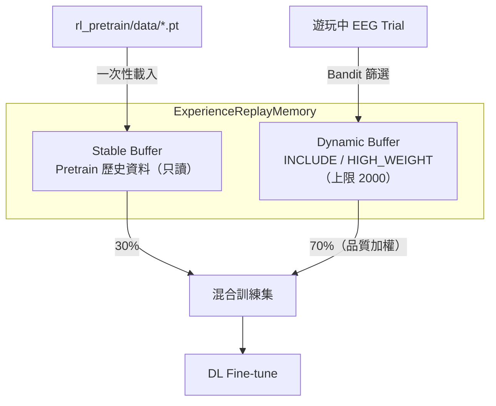
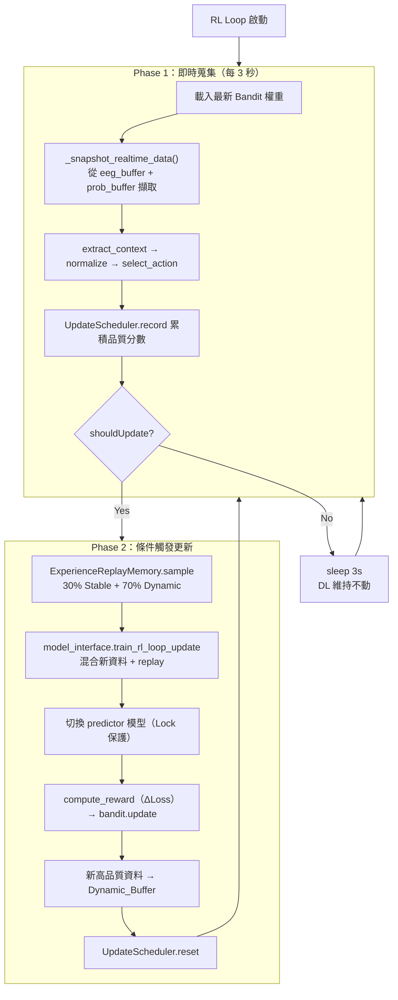

# combine_all_new RL 子系統完整分析

## 1. 總覽

RL 子系統的核心目標是：**在 BCI 遊戲遊玩過程中，智慧地決定每筆 EEG trial 資料的「品質處置策略」，以優化 EEG 分類模型的 online fine-tuning 效果**。

它使用 **NeuralUCB Contextual Bandit** 演算法，根據 EEG 信號特徵（context）選擇動作（納入/丟棄/加權），再利用模型訓練結果（ΔLoss）作為 reward 來更新 Bandit 策略。

---

## 2. 檔案結構與職責

| 檔案 | 職責 |
|---|---|
| [bandit.py](file:///d:/2026_BCI_-/combine_all_new/rl/bandit.py) | **核心演算法**：NeuralUCB Bandit、RewardMLP、UpdateScheduler、ContextNormalizer、ExperienceReplayMemory |
| [rl_interface.py](file:///d:/2026_BCI_-/combine_all_new/rl/rl_interface.py) | **RL 對外介面**：封裝 Bandit + Normalizer + Scheduler，提供 context 提取 |
| [rl_loop.py](file:///d:/2026_BCI_-/combine_all_new/core/rl_loop.py) | **Online RL 閉環**：背景線程，即時資料版兩階段架構 |
| [rl_pretrain.py](file:///d:/2026_BCI_-/combine_all_new/rl_pretrain.py) | **離線預訓練腳本**：用歷史資料預訓練 Bandit 策略 |
| [data_loader.py](file:///d:/2026_BCI_-/combine_all_new/eeg/data_loader.py) | **資料處理**：RL 決策蒐集 + Dataset 建構（含 replay 混合） |
| [model_interface.py](file:///d:/2026_BCI_-/combine_all_new/eeg/model_interface.py) | **DL 模型管理**：collect_rl_data / train_rl_loop_update |
| [app_controller.py](file:///d:/2026_BCI_-/combine_all_new/core/app_controller.py) | **主控制器**：組裝 RL 子系統，管理生命週期 |
| [intermission.py](file:///d:/2026_BCI_-/combine_all_new/core/intermission.py) | **結算畫面**：Calib 模式下觸發 RL reward 計算與 Bandit 更新 |
| [level_runner.py](file:///d:/2026_BCI_-/combine_all_new/core/level_runner.py) | **遊玩控制**：根據 `USE_RL_LOOP` 啟動 RL 背景線程 |
| [account_manager.py](file:///d:/2026_BCI_-/combine_all_new/core/account_manager.py) | **帳號管理**：載入/複製/初始化每個帳號的 Bandit 權重 |
| [config.py](file:///d:/2026_BCI_-/combine_all_new/config.py) | **設定**：`USE_RL_LOOP`、RL base model 路徑 |
| [global_state.py](file:///d:/2026_BCI_-/combine_all_new/global_state.py) | **全域狀態**：`RL_path`（Bandit 儲存路徑） |
| [test_rl.py](file:///d:/2026_BCI_-/combine_all_new/wait_to_use/test_rl.py) | **單元測試**：覆蓋 BanditAction、select_action、update、save/load、UpdateScheduler、ContextNormalizer |

---

## 3. 核心演算法：NeuralUCB Contextual Bandit

### 3.1 Action Space（4 個動作）

```python
class BanditAction(IntEnum):
    INCLUDE     = 0   # 以正常 stride 納入訓練 buffer
    DISCARD     = 1   # 丟棄這筆 trial
    HIGH_WEIGHT = 2   # 以 stride//2 高密度納入（更多 augmentation）
    LOW_WEIGHT  = 3   # 以 stride*2 低密度納入
```

> [!IMPORTANT]
> 動作透過**調整 sliding window stride** 來控制資料權重：stride 越小 → 同一段 EEG 產生越多 window → 在訓練中權重越高。

### 3.2 Context Vector（3 維）

Context 僅包含從 EEG data 濃縮出的**狀態描述**，`delta_loss` **不屬於 context**（僅用於 reward 計算）。

```python
class ContextIDX(IntEnum):
    MEAN_ENTROPY       = 0   # 模型預測的 entropy（不確定性）
    MEAN_MARGIN        = 1   # top-1 與 top-2 class 概率之差
    ALPHA_POWER_NORM   = 2   # Alpha band (8-13Hz) 能量（疲勞指標）

    context_dim        = 3
```

Context 提取邏輯在 [rl_interface.py:53-75](file:///d:/2026_BCI_-/combine_all_new/rl/rl_interface.py#L53-L75)：

```
entropy  = -Σ p·log(p)                    ← 預測不確定性
margin   = p_sorted[-1] - p_sorted[-2]    ← 決策確信度
alpha_p  = C3/Cz/C4 通道 Alpha 頻帶功率   ← 使用者疲勞度
```

### 3.3 NeuralUCB 選擇策略

每個 action 維護一個獨立的 **RewardMLP**（`context_dim → 64 → 32 → 1`）：

```
UCB_score(a) = MLP_a(context) + ε × ||∇_lastlayer MLP_a(context)||
               ─────────────   ──────────────────────────────────
                exploitation              exploration
```

選擇流程：
1. **Rule-based 保底**：若 `alpha > 0.85` 且 `entropy > 0.8` → 強制 `LOW_WEIGHT`（使用者疲勞）
2. **NeuralUCB**：計算所有 action 的 UCB score，取 argmax

### 3.4 Reward 公式

$$r_t = -\Delta Loss_t - \lambda \cdot T_t - \mu \cdot \gamma_t \cdot LQP^{base}_t$$

其中：
- **-ΔLoss**：loss 下降 → reward 為正（模型進步）
- **λ·T_t**：時間成本懲罰（`λ=0.1`，`T=1.0`）
- **μ·γ·LQP^base**：低品質數據懲罰
  - `LQP^base = w_e × mean_entropy`（`w_e=0.5`）
  - `γ = 1 + k × alpha × entropy`（`k=1.0`，alpha-entropy 交互放大）

Reward clip 至 `[-2.0, 2.0]`。

> [!NOTE]
> `deltaLoss` 僅在 reward 計算中使用，不作為 context 的一部分。這是因為 context 應僅描述 data 的即時狀態，而 deltaLoss 是 DL 訓練後才知道的結果信號。

### 3.5 MLP 更新機制

- 每次收到 reward → 加入對應 action 的 **Experience Replay Buffer**（`maxlen=500`）
- Mini-batch 隨機抽樣（`batch_size=32`）
- 訓練 5 個 epoch
- 使用 MSELoss + Adam（`lr=1e-3`）

### 3.6 超參數匯總

| 超參數 | 預設值 | 說明 |
|---|---|---|
| `epsilon` | 0.5 | 探索強度 |
| `lambdaCost` | 0.1 | 時間成本權重 |
| `mu` | 0.3 | LQP 懲罰權重 |
| `alp_ent_hyp` | 1.0 | alpha-entropy 交互強度 |
| `weightEntropy` | 0.5 | entropy 懲罰權重 |
| `rewardClipMin/Max` | -2.0 / 2.0 | reward 裁剪範圍 |
| `replayBufferSize` | 500 | Bandit MLP 的 replay buffer 大小 |
| `mlpLearningRate` | 1e-3 | MLP 學習率 |
| `miniBatchSize` | 32 | mini-batch 大小 |
| `updateEpochs` | 5 | 每次更新的 epoch 數 |

---

## 4. UpdateScheduler — 加權品質積分制

[bandit.py:483-551](file:///d:/2026_BCI_-/combine_all_new/rl/bandit.py#L483-L551) 中定義的**積分制觸發器**，解耦 DL 更新與 Bandit 決策：

| Action | 品質分數 |
|---|---|
| HIGH_WEIGHT | 2.0 |
| INCLUDE | 1.0 |
| LOW_WEIGHT | 0.3 |
| DISCARD | 0.0 |

- 每次 Bandit 做完決策 → `record(action)` 累加品質分數
- **累積分數 ≥ `scoreThreshold`（預設 7.0）時** → 回傳 `shouldUpdate = True`
- 觸發 DL 更新後 → `reset()` 清零重新累積

> [!TIP]
> 這個設計確保了「只有累積到足夠多高品質資料時才觸發 DL 更新」，避免頻繁且低效的 online 訓練。

---

## 5. ContextNormalizer — EMA + Sigmoid 正規化

[bandit.py:557-609](file:///d:/2026_BCI_-/combine_all_new/rl/bandit.py#L557-L609)

使用 **EMA（指數移動平均）** 追蹤 mean 和 variance，替代舊版 running min-max，避免離群值永久發散。

**正規化流程**：
1. EMA 更新 mean 和 variance（`α=0.05`）
2. 計算 z-score：`z = (raw - emaMean) / sqrt(emaVar + ε)`
3. **sigmoid 壓縮**：`normalized = 1 / (1 + exp(-z))` → 輸出 `[0, 1]`
4. 第一筆資料回傳中性值 **0.5**（無法正規化）

> [!NOTE]
> 與舊版 running min-max 的差異：EMA 對離群值有指數衰減的遺忘效果，不會因為一次極端值就永久拉大 min-max 範圍。

---

## 6. ExperienceReplayMemory — 雙重緩衝架構

[bandit.py:618-869](file:///d:/2026_BCI_-/combine_all_new/rl/bandit.py#L618-L869) — 防止 DL 在 RL Loop 中過擬合：



**品質加權抽樣**：Dynamic_Buffer 中的每筆資料附帶 `qualityScore`（`HIGH_WEIGHT=2.0`，`INCLUDE=1.0`），抽樣時以此為機率權重。

**空抽防護**：若某個 buffer 為空，自動將其配額轉給另一個 buffer（例如 Stable 為空 → 全部從 Dynamic 抽取）。

**持久化**：
- `save_buffer(path, topK=100)`：按品質排序，保留 top-100 → `hq_buffer.pt`
- `load_buffer(path)`：下次登入時預填 Dynamic_Buffer

---

## 7. Online RL Loop — 即時資料版兩階段架構

[rl_loop.py](file:///d:/2026_BCI_-/combine_all_new/core/rl_loop.py) 在背景線程中執行。

> [!IMPORTANT]
> 與舊版的關鍵差異：**資料來源從讀取歷史 .pt 檔改為即時從 `global_state.eeg_buffer` + `prob_buffer` 擷取 real-time data**（每 3 秒一次）。

### 7.1 即時資料擷取 (`_snapshot_realtime_data`)

[rl_loop.py:80-120](file:///d:/2026_BCI_-/combine_all_new/core/rl_loop.py#L80-L120)

1. 從 `global_state.eeg_buffer` 擷取最新 `BUFFER_SIZE` 的 EEG snapshot（使用 `buffer_lock` 保護）
2. 從 `global_state.prob_buffer` 取最新預測機率
3. 前處理：`demean → bandpass`（與 predict_loop 一致）
4. 回傳 `hit_data`（context 提取用）+ `segment`（訓練用）+ `label`（預測類別）

### 7.2 兩階段流程



> [!IMPORTANT]
> **設計原則**：歌曲進行中 DL 維持 `DL_n` 不動，只累積即時資料；積分滿 7.0 才觸發一次 `DL_n → DL_{n+1}` 更新。

---

## 8. Offline Pretrain 流程

[rl_pretrain.py](file:///d:/2026_BCI_-/combine_all_new/rl_pretrain.py) 的 `RLPretrainer` 類別：

1. 載入 `rl/rl_pretrain/data/` 下的 .pt 歷史資料
2. 對每個 epoch × 每個 .pt 檔案：
   - 對訓練集 trial 做 context extraction（3 維，不含 deltaLoss）→ normalize → Bandit select_action
   - **Min Retain Ratio**（`50%`）：若被 DISCARD 的比例太高，隨機升級部分為 INCLUDE
   - Sliding window augmentation → 建構 train/valid dataset
   - 訓練 EEGNet → 取得 val_loss
   - 計算 `ΔLoss` → `compute_reward` → `bandit.update` 更新所有 record
3. **EWMA 早停**：`ewmaReward > threshold（0.3）`且至少 2 輪更新 → 停止
4. 儲存至 `rl/rl_pretrain/pretrained_bandit.pt`

**CLI 參數**：
```
--pretrain-epochs   (default: 10)
--ewma-threshold    (default: 0.3)
--score-threshold   (default: 15.0)
--min-retain-ratio  (default: 0.5)
--dry-run           (跳過 DL 訓練，用 fake reward)
```

---

## 9. 結算（Intermission）中的 RL 更新

[intermission.py:47-69](file:///d:/2026_BCI_-/combine_all_new/core/intermission.py#L47-L69)

當使用者按下 **C（Calib）** 時：
1. `model_interface.train_or_calib(mode=1, RL_open=True)` → 內部做 Bandit 決策 + DL fine-tune
2. 同步 `RL_interface.deltaValLoss = model_interface.deltaValLoss`
3. 對所有 session_records 逐一：`compute_reward(ΔLoss, entropy, alpha)` → `bandit.update`

---

## 10. 帳號系統中的 RL 持久化

[account_manager.py:51-63](file:///d:/2026_BCI_-/combine_all_new/core/account_manager.py#L51-L63)

每個帳號目錄下有：
- `bandit.pt` — Bandit 權重（NeuralUCB MLP + replay buffer + history）
- `hq_buffer.pt` — 高品質 Experience Replay 緩衝（跨 session 持久化）

初始化邏輯：
```
如果 account/{user}/bandit.pt 存在 → 載入
否則如果 rl/rl_base_model/pretrained_bandit.pt 存在 → 複製過去再載入
否則 → 儲存新初始化的空 Bandit
```

---

## 11. 完整資料流

```mermaid
flowchart LR
    EEG["EEG 信號<br/>32ch@500Hz"] --> Reader[eeg_reader]
    Reader --> Buffer[global_state.eeg_buffer]
    Buffer --> Predictor["eeg_predictor<br/>EEGNet 推論"]
    Predictor --> Probs["probs（4-class）"]

    subgraph RL_Decision["RL 決策（即時）"]
        Snapshot["_snapshot_realtime_data<br/>每 3 秒擷取"] --> Context["Context 提取（3 維）<br/>entropy, margin, alpha"]
        Context --> Normalize["ContextNormalizer<br/>EMA + sigmoid"]
        Normalize --> Bandit["NeuralUCB<br/>select_action"]
        Bandit --> Action["Action<br/>INCLUDE / DISCARD /<br/>HIGH / LOW"]
    end

    Buffer --> Snapshot
    Probs --> Snapshot

    subgraph DL_Update["DL 更新（積分觸發）"]
        Action --> Scheduler["UpdateScheduler<br/>累積品質分數"]
        Scheduler -->|"≥7.0"| Trigger[觸發更新]
        Trigger --> Replay["ExperienceReplayMemory<br/>30% Stable + 70% Dynamic"]
        Replay --> Train["EEGNet Fine-tune<br/>rl_ft_pipeline"]
        Train --> ValLoss["val_loss → ΔLoss"]
        ValLoss --> Reward["compute_reward<br/>r = -ΔLoss - λT - μγLQP"]
        Reward --> Update["bandit.update<br/>mini-batch MLP"]
    end

    Action -->|stride 調整| SlidingWindow["Sliding Window<br/>Augmentation"]
    SlidingWindow --> Dataset[TensorDataset]
    Dataset --> Train
```



---

## 12. 設定與路徑總覽

| 設定 | 值 | 檔案 |
|---|---|---|
| `USE_RL_LOOP` | `False`（預設關閉） | [config.py:91](file:///d:/2026_BCI_-/combine_all_new/config.py#L91) |
| `bandit_RL` | `"bandit.pt"` | [config.py:80](file:///d:/2026_BCI_-/combine_all_new/config.py#L80) |
| `RL_CHECKPOINT_MAIN_BASE_FILE` | `rl/rl_base_model` | [config.py:102](file:///d:/2026_BCI_-/combine_all_new/config.py#L102) |
| `rl_base_base_model` | `rl/rl_base_model/pretrained_bandit.pt` | [config.py:103](file:///d:/2026_BCI_-/combine_all_new/config.py#L103) |
| `global_state.RL_path` | `account/{user}/bandit.pt` | [global_state.py:40](file:///d:/2026_BCI_-/combine_all_new/global_state.py#L40) |
| `RL_LOOP_INTERVAL` | `3.0` 秒 | [rl_loop.py:26](file:///d:/2026_BCI_-/combine_all_new/core/rl_loop.py#L26) |

---

## 13. 磁碟上的 RL 資產

```
rl/
├── __init__.py
├── bandit.py                        ← 核心演算法（869 行）
├── rl_interface.py                  ← RL 對外介面
├── rl_base_model/
│   └── pretrained_bandit.pt         ← 預訓練好的 Bandit（690 KB）
└── rl_pretrain/
    ├── data/                        ← pretrain 用 .pt 資料
    ├── log/                         ← pretrain 執行 log
    ├── pretrained_bandit.pt         ← pretrain 輸出
    ├── pretrained_bandit_old.pt     ← 舊版備份
    ├── train.pth                    ← pretrain 用的 base EEGNet
    ├── test0.pt / test1.pt          ← 測試用資料
    └── record.md                    ← pretrain 記錄
```

---

## 14. 與前版的主要差異

| 項目 | 舊版 | 新版 |
|---|---|---|
| **Context 維度** | 4 維（含 `DELTA_LOSS`） | **3 維**（移除 `DELTA_LOSS`） |
| **Context 語義** | 混合 data 狀態 + 訓練結果 | **純 data 狀態描述**（delta_loss 僅用於 reward） |
| **ContextNormalizer** | Running min-max | **EMA（α=0.05）+ sigmoid** 壓縮 |
| **第一筆回傳值** | 全 0 | **0.5**（中性值） |
| **RL Loop 資料來源** | 讀取歷史 .pt 檔 | **即時從 `eeg_buffer` + `prob_buffer` 擷取** |
| **RL Loop 擷取頻率** | 依 .pt 檔數量 | **每 3 秒一次**（`RL_LOOP_INTERVAL`） |
| **ExperienceReplay 空抽** | 可能報錯 | **自動配額轉移**（空 buffer 的比例分給另一個） |
| **ExperienceReplay replace** | `replace=False` 可能報錯 | **自動切換 `replace=True`** 當抽樣數 > buffer 大小 |

---

## 15. 關鍵設計決策摘要

| 決策 | 原因 |
|---|---|
| **NeuralUCB 取代 LinUCB** | MLP 能捕捉非線性 context-reward 關係 |
| **Reward 用 ΔLoss 取代 ΔAcc** | Loss 更平滑，避免 accuracy 的離散跳動 |
| **Context 移除 deltaLoss** | context 應僅描述 data 的即時狀態，deltaLoss 是事後信號 |
| **EMA + sigmoid 正規化** | 替代 running min-max，避免離群值永久發散 |
| **即時資料擷取** | 直接從 eeg_buffer 取 real-time data，不依賴歷史 .pt 檔 |
| **ONLINE_UPDATE 從 action space 移除** | 由 UpdateScheduler 獨立排程，解耦決策與訓練觸發 |
| **積分制觸發** | 防止高頻低效更新，確保累積足夠高品質資料 |
| **雙重緩衝 Experience Replay** | Stable 30% 防遺忘 + Dynamic 70% 注入新知 |
| **Rule-based 保底** | alpha 極高 + entropy 極高 → 強制 LOW_WEIGHT，避免疲勞時的噪音資料 |
| **Min Retain Ratio** | 確保至少 50% trial 被保留，防止 Bandit 過度丟棄 |
